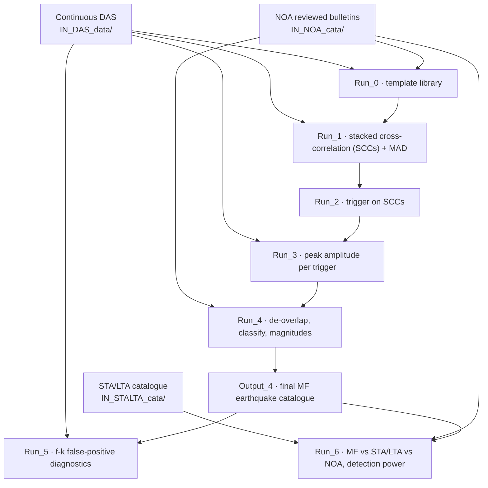
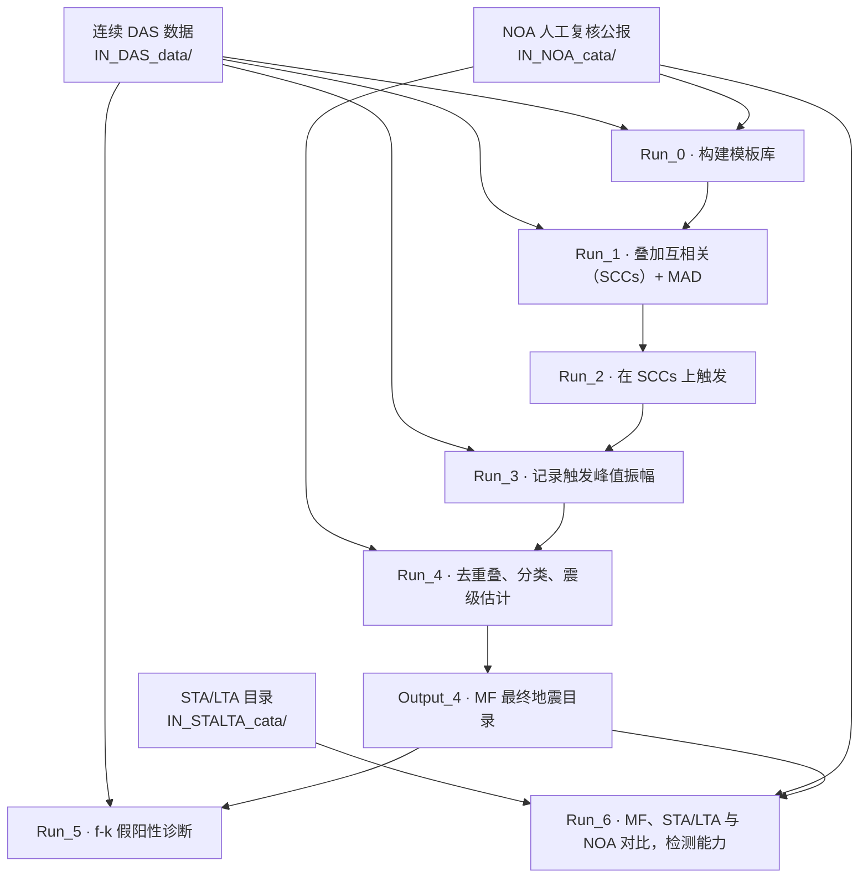

# yuhan-mfdas — Matched-Filter Earthquake Detection on the Kefalonia Seafloor DAS Cable

[](https://doi.org/10.5281/zenodo.20715241)
[](https://doi.org/10.22541/essoar.15006791/v1)
[](NOTICE)
[](requirements.txt)

[English](#english) · [中文](#中文)

## English

End-to-end **matched-filter (template-matching)** workflow for detecting and cataloguing
microearthquakes from Distributed Acoustic Sensing (DAS) strain-rate data recorded on the
Kefalonia seafloor telecom cable (Ionian Sea, Greece; April–June 2024), accompanying:

> *Persistent Faulting Activity Along the Kefalonia Transform Fault Revealed by Seafloor DAS*
> (Wang et al., 2026, preprint, https://doi.org/10.22541/essoar.15006791/v1).

A handful of high-SNR, mutually dissimilar known earthquakes are used as **templates**.
The pipeline slides each template along the continuous DAS record via stacked normalised
cross-correlation (SCCs), then automatically triggers, de-overlaps, classifies, and
estimates magnitudes — producing a microseismic catalogue more complete than either a
classic STA/LTA detector or the regional (NOA) bulletin, and quantifying its detection power.

This release is a single, clean main line distilled from the internal `matched_filter_v8`
project, with a self-contained path/import redesign so the folder runs in isolation
(only the large raw DAS data lives outside the package).

> **GitHub version.** This repository (`WANGYuhan2002/yuhan-mfdas`) corresponds to the
> `yuhan_dasmf_v1.0/` folder of the Zenodo software archive
> [10.5281/zenodo.20715241](https://doi.org/10.5281/zenodo.20715241) (v1.0.0; concept DOI
> [10.5281/zenodo.20715240](https://doi.org/10.5281/zenodo.20715240), archive file
> `matched_filter_release.zip`). It holds the code and documentation only; none of the data the
> scripts read (raw DAS sample, SCCs, MAD, templates, catalogues) is in this repository. See
> [Data availability](#data-availability) for which files each step needs, and
> [Differences from the Zenodo v1.0.0 archive](#differences-from-the-zenodo-v100-archive).

### Companion repositories

The supporting packages from `matched_filter_release.zip` are maintained in companion GitHub
repositories:

| Repository | Role | Folder in `matched_filter_release.zip` |
|---|---|---|
| **`WANGYuhan2002/yuhan-mfdas`** (this repo) | **Primary** — matched-filter (template-matching) detection & cataloguing pipeline (`Run_0` → `Run_6`). | `yuhan_dasmf_v1.0/` |
| `WANGYuhan2002/yuhan_das_spectra` | Spectral analysis tools for seafloor DAS: noise PSD / PPSD, per-magnitude earthquake spectra, and ERA5 noise–weather comparison (including the minimum detectable magnitude $M_c$ analysis and the pre-built noise/ERA5 products read from `IN_noise_meteo/`). | `check_minmag_pkg/` |
| `WANGYuhan2002/das_wavefront_picker` | Multichannel STA/LTA wavefront detection and interactive picking (includes the STA/LTA detector modules from `stalta_multichan_v1`). The paper's STA/LTA baseline outputs remain in the Zenodo archive under `stalta_multichan_v1/`. | `stalta_multichan_v1/` (baseline package & outputs in the zip) |

### Installation

Python 3.10–3.12 is recommended:

```bash
python -m venv .venv && source .venv/bin/activate   # or a conda environment
pip install -r requirements.txt   # core group is enough for the demo
```

`requirements.txt` pins `numpy>=1.23,<2.4`: the DAS reader `functions/load_das_h5_PE2024.py`
calls `int(offset_index)` on a one-element array, which raises `TypeError` with numpy 2.4 or
newer when DAS files are read (numpy 2.3 only warns).

### Quick start

```bash
pip install -r requirements.txt   # core group is enough for the demo
python demo.py                    # one matched-filter detection in a few seconds
```

`demo.py` uses the 2024-04-25 SCCs + MAD sample from the Zenodo archive (no big data / no
network needed) and prints the strongest detection (2024-04-25 11:02:13 UTC, score
**+417×MAD** — the template's own earthquake) and writes `demo_detection.png`.
In this GitHub version the two input files are not included: copy them from the Zenodo archive
first (see [Data availability](#data-availability)); without them `demo.py` stops with
"找不到 SCCs 文件" (SCCs file not found).

### Pipeline

The workflow is numbered sequentially, `Run_N` produces `Output_N`:

| Stage | Does |
|---|---|
| **Run_0 → Output_0** | Build the template library from the regional catalogue |
| **Run_1 → Output_1** | Stacked cross-correlation (SCCs) + MAD noise baseline |
| **Run_2 → Output_2** | Trigger on SCCs (threshold = MAD × level; with `max_stalta`) |
| **Run_3 → Output_3** | Record per-trigger peak amplitude |
| **Run_4 → Output_4** | De-overlap + classify + estimate magnitudes → **final earthquake catalogue** |
| **Run_5 → Output_5** | f-k filtering to flag false positives (diagnostic) |
| **Run_6 → Output_6** | Compare MF vs STA/LTA vs NOA; detection-power figures |

Data flow between the stages (inputs as listed in [`OVERVIEW.md`](OVERVIEW.md)):



`functions/` is the shared library imported by every stage. Each stage runs with
`python <script>.py` — scripts locate the project root automatically via the `.dasmf_root`
sentinel, so the whole folder can be moved anywhere without editing paths.

External data are also read from package-relative folders (in the Zenodo v1.0.0 code these
were the author's mount points): raw 80 Hz DAS from `IN_DAS_data/continuous_scan_1h/`
(laid out as `<folder>/YYYYMMDD/*.h5`; the 8 Hz and 400 Hz products from
`IN_DAS_data/DATA_DEC_8Hz_16m_SORTED/` and `IN_DAS_data/DATA_RAW_400Hz_8m/`), MFFI data from
`IN_MFFI_data/kefalonia_ts_h5_80Hz/`. Put or symlink your data there. Keep these exact
folders: `functions/das_mffi_io.py` and `functions/cluster.py` compare the folder string to
choose the reader and channel spacing.

### Data availability

The large continuous DAS data (~1.4 TB at 80 Hz; the full SCCs are another ~31 GB) is **not**
bundled. In the Zenodo archive ([10.5281/zenodo.20715241](https://doi.org/10.5281/zenodo.20715241),
file `matched_filter_release.zip`, about 3.46 GB, folder `yuhan_dasmf_v1.0/`) a **1-hour sample**
(2024-04-25 15:00–16:00) ships in `IN_DAS_data/` so `Run_1` can be demonstrated, and 2024-04-25
SCCs/MAD intermediate products are included so `demo.py` and downstream stages can run. The final
MF earthquake catalogue is in `Output_4_.../level_20/MagRegression/Events_classified_Real_Mag.csv`
of that archive: 17,326 detections (17,325 within the analysis window ending 2024-06-22 16:15;
17,263 after merging overlapping detections across templates).

**This GitHub repository contains none of these data files.** Copy the files you need from
`matched_filter_release.zip` (inside `yuhan_dasmf_v1.0/`) into the same relative paths in this
repository:

| To run | Files needed from `matched_filter_release.zip` (relative to `yuhan_dasmf_v1.0/`) |
|---|---|
| `demo.py` | `Output_1_SCCs_and_MAD/SCCs_h5/template_0423_80Hz/CCs_stack_template_0423_80Hz_UTC_20240425_110000.000000.h5` (one SCCs file, ~0.77 MB) and `Output_1_SCCs_and_MAD/MAD_arrays/20240424_102000_to_20240622_171000/12:00:00/MAD_Average_dict.pkl` (547 B) |
| `Run_1` (1-hour scan demo) | `IN_DAS_data/continuous_scan_1h/20240425/` (13 raw DAS files, ~1.1 GB) and `Output_0_Template_library/Template_npy_files/*.npy` (5 templates); set `t_all_start`/`t_all_end` in the script's `Config` to 2024-04-25 15:00–16:00 |
| `Run_2` → `Run_6` | the corresponding `Output_*` folders of the zip, `Output_0_Template_library/Template_library.csv` and `IN_STALTA_cata/sta_lta_catalog.csv`; Run_3 and Run_5 also re-read raw DAS at the trigger times; see the input section of each `Run_*/README.md` |
| noise/meteo plots (`Run_4_.../5_*`, `Output_1_.../MAD_arrays/999_*`) | `IN_noise_meteo/noise_trends_f8-20Hz_p5.h5`, `IN_noise_meteo/kefa_atmos_data.csv`, `IN_noise_meteo/kefa_wave_data.csv` (same-named product and ERA5 CSVs are also in the companion repository `WANGYuhan2002/yuhan_das_spectra` under `products/` and `meteo/`, or in `check_minmag_pkg/` inside `matched_filter_release.zip`) |

The NOA reviewed bulletins in `IN_NOA_cata/` (used by Run_0, Run_4 script 2b and Run_6) are
not redistributed here (link only): obtain them from the National Observatory of Athens,
Institute of Geodynamics (NOA-GEIN, https://www.gein.noa.gr/).

### Documentation

- **`OVERVIEW.md`** — full English walkthrough: data flow, run instructions, design decisions,
  and which scripts are main-line vs. ignorable.
- **`<folder>/README.md`** — per-folder English docs (inputs/outputs, script roles, data schemas).
- **`说明文档_总览.md`** and **`<folder>/说明文档.md`** — the same documentation in Chinese.

### Citation

If you use this code, please cite the paper (preprint):

> Wang, Y., Meier, M.-A., Bogris, A., Simos, C., Simos, I., Melis, N. S., & Fichtner, A. (2026).
> *Persistent Faulting Activity Along the Kefalonia Transform Fault Revealed by Seafloor DAS*
> [Preprint]. https://doi.org/10.22541/essoar.15006791/v1

and this software release (Zenodo, v1.0.0): https://doi.org/10.5281/zenodo.20715241
(concept DOI, all versions: 10.5281/zenodo.20715240). A machine-readable citation is in
[`CITATION.cff`](CITATION.cff).

### License

MIT — see [`LICENSE`](LICENSE). © 2026 Yuhan Wang.

Exceptions — see [`NOTICE`](NOTICE):

- `functions/pydas_readers/util/block_filters.py` contains code taken from ObsPy and is under the
  GNU LGPL-3.0, not MIT (full texts in [`LICENSES/`](LICENSES/)).
- `functions/pydas_readers/` (Daniel Bowden, ETH Zürich) and `functions/load_das_h5_PE2024.py`
  (Pascal Edme, ETH Zürich, derived from code by Sara Klaasen and Daniel Bowden) are third-party
  code without a licence of their own; they are redistributed here for research and reproducibility
  with the permission of the original authors.

### Differences from the Zenodo v1.0.0 archive

This GitHub version is the code of `yuhan_dasmf_v1.0/` in the Zenodo v1.0.0 archive plus
portability and metadata fixes; no numerics, thresholds, algorithms, processing order or default
parameters were changed.

- **Not included:** all raw DAS data and the other data/intermediate products of the archive (SCCs,
  MAD, templates, catalogues, STA/LTA snapshots, noise/meteo files), the NOA bulletins, third-party
  channel-mapping tables of an unrelated DAS deployment, the author's planning notes, and OS/editor
  junk files.
- **Paths:** hard-coded absolute paths of the author's machines were replaced by package-relative
  paths (for example raw 80 Hz DAS is read from `IN_DAS_data/continuous_scan_1h/`); the same files
  are read and written.
- **Metadata and documentation:** paper title, preprint DOI and author names, Zenodo DOIs, event
  counts, contact (GitHub instead of e-mail) and the statements about which data are included were
  corrected; `numpy<2.4` was pinned; `NOTICE`, `LICENSES/`, `CITATION.cff` and `.gitignore` were added.

The file-by-file change log is kept with the release-preparation records.

### Known issues

- **numpy < 2.4.** `functions/load_das_h5_PE2024.py` calls `int(offset_index)` on a one-element
  array; with numpy 2.4 or newer this raises `TypeError` when DAS files are read (numpy 2.3 only
  warns). `requirements.txt` therefore pins `numpy>=1.23,<2.4`.
- **Missing inputs are not always reported as errors.** 9 scripts in this repository exit with
  status 0 when their input files are missing. Check that the input data are in place first.
- **Folder names with colons.** The MAD folder `12:00:00` (from the Zenodo archive) contains
  colons, which Windows file systems do not allow.
- The two paper-figure scripts `Output_0_Template_library/4_*_for_paper.py` and
  `Run_4_assign_overlaps_with_kurtosis/5_999_*.py` refer to an unpublished plotting repository as a
  fallback (`external/GRL_DAS_MF_plots/functions/`); the modules they import are taken from
  `functions/` first.

---

## 中文

本仓库（`WANGYuhan2002/yuhan-mfdas`）是下面这篇论文的**模板匹配（matched filter）微地震检测与编目主流程**代码：

> *Persistent Faulting Activity Along the Kefalonia Transform Fault Revealed by Seafloor DAS*
> （Wang et al., 2026，预印本，https://doi.org/10.22541/essoar.15006791/v1）。

代码以少数几个高信噪比、互不相似的已知地震作为**模板**，沿希腊伊奥尼亚海 Kefalonia 海底通信光缆的连续分布式声学传感（DAS）应变率记录（2024 年 4–6 月）做叠加归一化互相关（SCCs）滑动匹配，自动完成触发、跨模板去重叠、分类与震级标定，产出比经典 STA/LTA 检测器或区域（NOA）台网公报更完备的微地震目录，并定量评估其检测能力。

本发布版是从内部工程 `matched_filter_v8` 提炼出的单一干净主线，做了自包含的路径与导入改造，整个目录可独立运行（只有体量巨大的原始 DAS 数据放在包外）。

> **GitHub 版说明。** 本仓库对应 Zenodo 软件存档
> [10.5281/zenodo.20715241](https://doi.org/10.5281/zenodo.20715241)（v1.0.0；概念 DOI
> [10.5281/zenodo.20715240](https://doi.org/10.5281/zenodo.20715240)，压缩包文件名
> `matched_filter_release.zip`）里的 `yuhan_dasmf_v1.0/` 文件夹。本仓库只包含代码和说明文档，不含脚本读取的数据与中间产物（原始 DAS 样本、SCCs、MAD、模板、目录）。各步骤所需文件见下文「数据」，与 Zenodo 存档的差异见「与 Zenodo v1.0.0 存档的差别」。

### 配套仓库

`matched_filter_release.zip` 中的辅助工具与配套代码分别位于以下同系列 GitHub 仓库：

| 仓库 | 作用 | 在 `matched_filter_release.zip` 中的对应目录 |
|---|---|---|
| **`WANGYuhan2002/yuhan-mfdas`**（本仓库） | **主体**：模板匹配（matched filter）检测与编目主线流程（`Run_0` → `Run_6`）。 | `yuhan_dasmf_v1.0/` |
| `WANGYuhan2002/yuhan_das_spectra` | 海底 DAS 频谱分析工具：噪声 PSD / PPSD、按震级分档的地震谱，以及与 ERA5 风浪的对比（含最小可检测震级 $M_c$ 分析，以及本库 `IN_noise_meteo/` 读取的预制噪声成品和 ERA5 表格）。 | `check_minmag_pkg/` |
| `WANGYuhan2002/das_wavefront_picker` | 多通道 STA/LTA 波前检测与交互拾取（已包含 `stalta_multichan_v1` 的 STA/LTA 检测模块）。论文使用的 STA/LTA 对比基线原始输出保存在 Zenodo 压缩包的 `stalta_multichan_v1/` 目录中。 | `stalta_multichan_v1/`（压缩包内的基线包与输出） |

### 安装

建议使用 Python 3.10–3.12：

```bash
python -m venv .venv && source .venv/bin/activate   # 或使用 conda 环境
pip install -r requirements.txt   # 跑 demo 只需安装核心组依赖
```

`requirements.txt` 锁定了 `numpy>=1.23,<2.4`：底层读取器 `functions/load_das_h5_PE2024.py` 对单元素数组调用 `int(offset_index)`，在 numpy 2.4 及以上读取 DAS 文件时会抛出 `TypeError`（numpy 2.3 仅给出警告）。

### 快速开始

```bash
pip install -r requirements.txt   # 跑 demo 只需核心组
python demo.py                    # 几秒钟完成一次模板匹配检测
```

`demo.py` 使用 Zenodo 存档里的 2024-04-25 SCCs + MAD 样本（无需大数据、无需联网），打印最强检测（2024-04-25 11:02:13 UTC，匹配度 **+417×MAD**，即模板自身地震）并生成 `demo_detection.png`。
本 GitHub 版不含这两个输入文件：请先从 Zenodo 存档拷入（见「数据」一节）；缺少输入时 `demo.py` 会报错「找不到 SCCs 文件」并退出。

### 管线概览

流程按顺序编号，`Run_N` 产出 `Output_N`：

| 阶段 | 功能 |
|---|---|
| **Run_0 → Output_0** | 从区域台网目录构建模板库 |
| **Run_1 → Output_1** | 计算叠加互相关（SCCs）与 MAD 噪声基准 |
| **Run_2 → Output_2** | 在 SCCs 上触发检测（阈值 = MAD × level，附带 `max_stalta`） |
| **Run_3 → Output_3** | 记录每次触发的峰值振幅 |
| **Run_4 → Output_4** | 去重叠 + 分类 + 震级估计 → **最终地震目录** |
| **Run_5 → Output_5** | f-k 滤波假阳性诊断图 |
| **Run_6 → Output_6** | MF、STA/LTA 与 NOA 三目录对比及检测能力图 |

各阶段之间的数据流（输入按 [`说明文档_总览.md`](说明文档_总览.md) 所列）：



`functions/` 是各阶段共用的函数库。进入任一阶段直接运行 `python <script>.py` 即可——脚本通过 `.dasmf_root` 哨兵文件自动定位项目根目录，整个文件夹移动到任意位置都无需手改路径。

外部数据统一从包内相对目录读取（Zenodo v1.0.0 代码里曾是作者机器的挂载路径）：80 Hz 原始 DAS 从 `IN_DAS_data/continuous_scan_1h/` 读取（目录结构 `<folder>/YYYYMMDD/*.h5`；8 Hz 和 400 Hz 数据分别在 `IN_DAS_data/DATA_DEC_8Hz_16m_SORTED/` 和 `IN_DAS_data/DATA_RAW_400Hz_8m/`），MFFI 数据从 `IN_MFFI_data/kefalonia_ts_h5_80Hz/` 读取。请将数据放入或软链接到上述目录，并保持目录名不变（`functions/das_mffi_io.py` 和 `functions/cluster.py` 通过比较目录字符串来选择读取函数和道间距）。

### 数据

连续 DAS 数据集（80 Hz 下约 1.4 TB；全量 SCCs 另有约 31 GB）**不随库附带**。在 Zenodo 存档（[10.5281/zenodo.20715241](https://doi.org/10.5281/zenodo.20715241)，文件 `matched_filter_release.zip`，约 3.46 GB，`yuhan_dasmf_v1.0/` 目录）中，`IN_DAS_data/` 附带了 **1 小时原始 DAS 样本**（2024-04-25 15:00–16:00）用于演示 `Run_1`，并附带了 2024-04-25 的 SCCs/MAD 中间产物供 `demo.py` 和下游步骤运行。最终模板匹配地震目录位于该存档的 `Output_4_.../level_20/MagRegression/Events_classified_Real_Mag.csv`：共 17,326 条检测（其中 17,325 条在截至 2024-06-22 16:15 的分析时窗内；跨模板合并重叠检测后为 17,263 条）。

**本 GitHub 仓库不含任何数据文件。** 请按需从 `matched_filter_release.zip`（`yuhan_dasmf_v1.0/` 下）把文件拷入本仓库相同的相对路径：

| 运行目标 | 需从 `matched_filter_release.zip`（相对于 `yuhan_dasmf_v1.0/`）拷入的文件 |
|---|---|
| `demo.py` | `Output_1_SCCs_and_MAD/SCCs_h5/template_0423_80Hz/CCs_stack_template_0423_80Hz_UTC_20240425_110000.000000.h5`（1 个 SCCs 文件，约 0.77 MB）和 `Output_1_SCCs_and_MAD/MAD_arrays/20240424_102000_to_20240622_171000/12:00:00/MAD_Average_dict.pkl`（547 B） |
| `Run_1`（1 小时扫描演示） | `IN_DAS_data/continuous_scan_1h/20240425/`（13 个原始 DAS 文件，约 1.1 GB）和 `Output_0_Template_library/Template_npy_files/*.npy`（5 个模板）；将脚本 `Config` 中的 `t_all_start`/`t_all_end` 设为 2024-04-25 15:00–16:00 |
| `Run_2` → `Run_6` | 压缩包中对应的 `Output_*` 目录、`Output_0_Template_library/Template_library.csv` 和 `IN_STALTA_cata/sta_lta_catalog.csv`；Run_3 和 Run_5 还会在触发时刻回读原始 DAS（详见各 `Run_*/说明文档.md`） |
| 噪声/气象出图（`Run_4_.../5_*`、`Output_1_.../MAD_arrays/999_*`） | `IN_noise_meteo/noise_trends_f8-20Hz_p5.h5`、`IN_noise_meteo/kefa_atmos_data.csv`、`IN_noise_meteo/kefa_wave_data.csv`（同名成品和 ERA5 CSV 也保存在配套仓库 `WANGYuhan2002/yuhan_das_spectra` 的 `products/` 与 `meteo/` 下，以及 `matched_filter_release.zip` 的 `check_minmag_pkg/` 中） |

`IN_NOA_cata/` 中的 NOA 审核公报（Run_0、Run_4 脚本 2b 和 Run_6 使用）不在本仓库转存（仅给出处）：请从雅典国家天文台地球动力学研究所（NOA-GEIN，https://www.gein.noa.gr/）获取。

### 文档导航

- **`说明文档_总览.md`** —— 中文端到端总览：数据流、运行说明、设计取舍，以及主线脚本与可忽略脚本的划分。
- **`<目录>/说明文档.md`** —— 各子目录中文说明文档（输入/输出、脚本职责、数据结构）。
- **`OVERVIEW.md`** 与 **`<目录>/README.md`** —— 对应的英文说明文档。

### 引用

使用本代码请引用论文（预印本）：

> Wang, Y., Meier, M.-A., Bogris, A., Simos, C., Simos, I., Melis, N. S., & Fichtner, A. (2026).
> *Persistent Faulting Activity Along the Kefalonia Transform Fault Revealed by Seafloor DAS*
> [Preprint]. https://doi.org/10.22541/essoar.15006791/v1

以及本软件存档（Zenodo，v1.0.0）：https://doi.org/10.5281/zenodo.20715241（概念 DOI，指向所有版本：
10.5281/zenodo.20715240）。机器可读的引用信息见 [`CITATION.cff`](CITATION.cff)。

### 许可证

MIT，见 [`LICENSE`](LICENSE)。© 2026 Yuhan Wang。

例外（见 [`NOTICE`](NOTICE)）：

- `functions/pydas_readers/util/block_filters.py` 含有从 ObsPy 拷来的代码，按 GNU LGPL-3.0 发布，不是 MIT（许可证全文见 [`LICENSES/`](LICENSES/)）。
- `functions/pydas_readers/`（Daniel Bowden，ETH Zürich）和 `functions/load_das_h5_PE2024.py`（Pascal Edme，ETH Zürich，源自 Sara Klaasen 和 Daniel Bowden 的代码）是没有自带许可证的第三方代码，经原作者许可，为科研和可复现目的随包再分发。

### 与 Zenodo v1.0.0 存档的差别

本 GitHub 版 = Zenodo v1.0.0 存档中 `yuhan_dasmf_v1.0/` 的代码 + 可移植性和元数据修改；没有改动任何数值、阈值、算法、处理顺序或默认参数。

- **不包含**：所有原始 DAS 数据，以及存档里的其它数据和中间产物（SCCs、MAD、模板、目录、STA/LTA 快照、噪声与气象文件）、NOA 公报、属于另一个 DAS 部署的第三方通道映射表、作者的规划文档、系统和编辑器产生的垃圾文件。
- **路径**：作者机器上写死的绝对路径改成了包内相对路径（例如 80 Hz 原始 DAS 从 `IN_DAS_data/continuous_scan_1h/` 读取）；读写的仍是同样的文件。
- **元数据和文档**：改正了论文标题、预印本 DOI 和作者姓名、Zenodo DOI、事件数、联系方式（用 GitHub 代替邮箱），以及关于哪些数据随包附带的说法；锁定 `numpy<2.4`；新增 `NOTICE`、`LICENSES/`、`CITATION.cff` 和 `.gitignore`。

逐文件的修改记录保存在发布准备记录里。

### 已知问题

- **numpy < 2.4。** `functions/load_das_h5_PE2024.py` 对单元素数组调用 `int(offset_index)`；numpy 2.4 及以上读 DAS 文件时会抛 `TypeError`（numpy 2.3 只给警告）。因此 `requirements.txt` 锁定了 `numpy>=1.23,<2.4`。
- **缺输入时不一定报错。** 本仓库中有 9 个脚本在缺少输入文件时以状态码 0 退出。运行前请先确认输入数据已就位。
- **目录名里有冒号。** MAD 目录 `12:00:00`（来自 Zenodo 存档）的名字带冒号，Windows 文件系统不允许这样的目录名。
- 两个论文出图脚本 `Output_0_Template_library/4_*_for_paper.py` 和 `Run_4_assign_overlaps_with_kurtosis/5_999_*.py` 把一个未公开的出图仓库作为后备路径（`external/GRL_DAS_MF_plots/functions/`）；它们导入的模块会先从本仓库的 `functions/` 解析。
